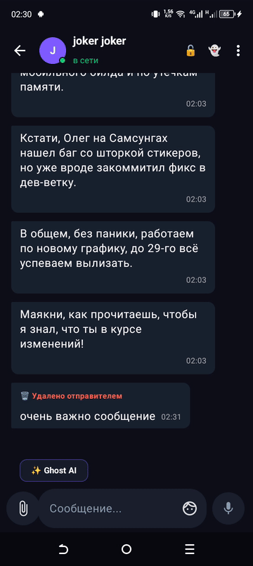
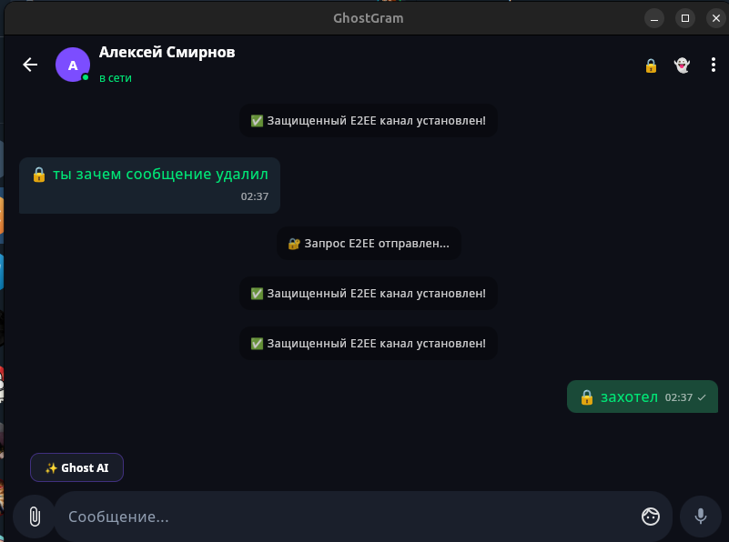
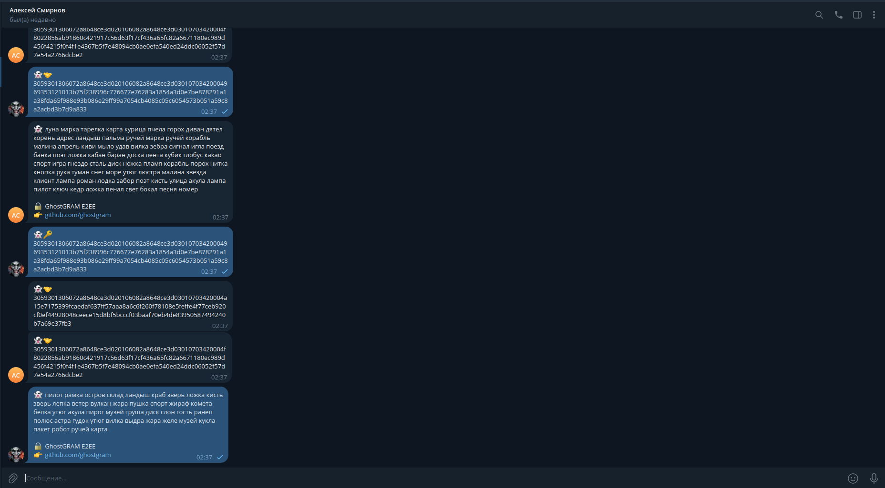
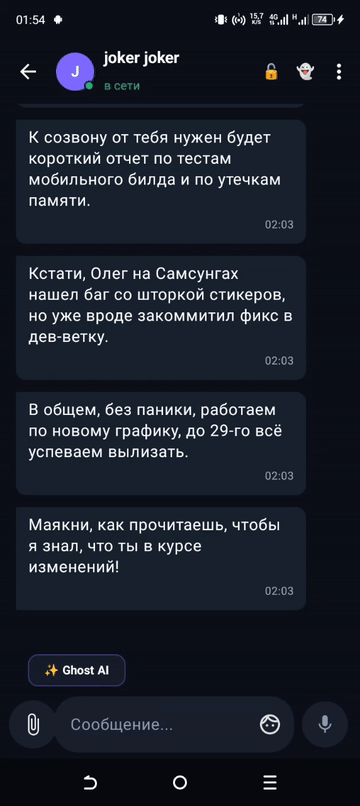
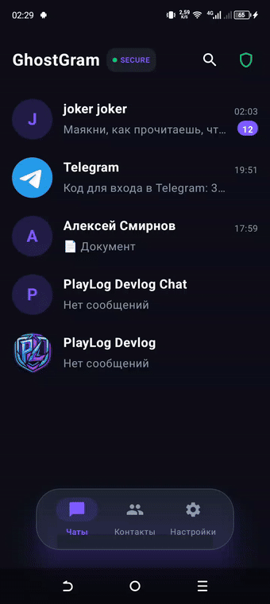
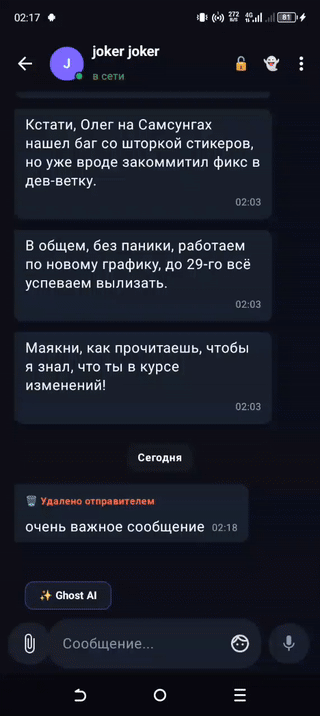

<p align="center">
  
</p>

<h1 align="center">GhostGRAM 👻</h1>

<p align="center">
  <strong>An experimental Telegram client built with Kotlin, Compose Multiplatform, and TDLib.</strong><br />
  Exploring alternative message search, local message history, AI-assisted messaging, and cross-platform app architecture.
</p>

<p align="center">
  <a href="https://kotlinlang.org"></a>
  <a href="https://www.jetbrains.com/compose-multiplatform/"></a>
  <a href="https://core.telegram.org/tdlib"></a>
  <a href="https://www.gnu.org/licenses/gpl-3.0"></a>
  
</p>

> **Project status:** GhostGRAM is an independent, experimental project. Features and platform support may be incomplete or change between versions. It is not recommended as a replacement for an established messaging client when reliability or security is critical.

> **Unofficial project:** GhostGRAM is not affiliated with, authorized, maintained, sponsored, or endorsed by Telegram FZ-LLC. Telegram names and trademarks belong to their respective owners.

## Contents

- [Overview](#overview)
- [Features](#features)
- [Experimental word-based message encoding](#experimental-word-based-message-encoding)
- [Architecture and technology](#architecture-and-technology)
- [Platforms and downloads](#platforms-and-downloads)
- [Build from source](#build-from-source)
- [Known limitations](#known-limitations)
- [License](#license)

## Overview

GhostGRAM is a personal engineering project exploring how a Telegram client can be built with Kotlin and Compose Multiplatform on top of TDLib. The project experiments with features that go beyond a basic chat interface, including regex-assisted search, locally retained message history, Gemini-powered tools, and a prototype that encodes encrypted data as dictionary words.

The project is under active development. This repository documents experiments and implementation choices; it does not claim feature parity with the official Telegram clients or provide independently verified security guarantees.

## Features

### 🥷 Experimental word-based message encoding

GhostGRAM includes a prototype called **Ghost Shield**. It combines ECDH P-256 key exchange and AES-GCM encryption with a `WordCoder` that represents encoded data as Russian dictionary words.

<p align="center">
  
</p>

<p align="center">
  
  
</p>

This is a **demonstration and research prototype, not production-ready secure messaging**. See [Experimental word-based message encoding](#experimental-word-based-message-encoding) for the current limitations.

### 🛡️ Locally retained deleted messages

GhostGRAM has an **anti-revoke** feature intended to retain local copies of messages that the client received and stored before they were deleted in Telegram.

<p align="center">
  
</p>

This feature cannot recover a message the client never received or stored. Retention also depends on the local database state and the app's behavior at the time the message is deleted.

### 🧠 Gemini-assisted catch-up and smart replies

The app experiments with chat catch-up/summarization and contextual reply suggestions using the Google Gemini API. The integration uses a **bring-your-own-key (BYOK)** approach.

<p align="center">
  
</p>

This is **not on-device AI**: the feature relies on the Gemini API. Message text or context submitted to an AI feature may be sent to Google for processing. Review the data flow and applicable service terms before using it with private conversations.

### 🔍 Regex-assisted search

GhostGRAM includes client-side search/filtering with regular-expression support, intended to make it easier to narrow results and find specific patterns in message content.

This is a local search aid, not a guarantee that Telegram's server-side search is free of spam, nor a universal spam-blocking system.

### 🎨 Compose UI experiments

The interface includes custom message layouts, swipe-to-reply interactions, animated media/stickers, and other Compose Multiplatform UI experiments.

<p align="center">
  
</p>

## Experimental word-based message encoding

The Ghost Shield prototype is included to demonstrate a possible encoding workflow and to explore its trade-offs. **Do not rely on it to protect sensitive or high-risk communications.** It has not undergone an independent security audit and should not be considered a reviewed end-to-end encryption protocol.

Known limitations include:

- **Man-in-the-middle risk:** the current key-exchange flow does not provide sufficient authenticated peer identity to rule out key-substitution attacks. A third party may be able to interfere with the exchange.
- **Message-length expansion:** encoding ciphertext as words substantially increases the size of a message. Telegram's standard text-message length limit is around 4,096 characters, so encoded messages can exceed the limit even when the original message is short.
- **No guaranteed concealment:** word-based encoding does not guarantee that a message will appear indistinguishable from ordinary conversation or evade detection.
- **No independent audit:** the implementation is experimental. The use of established cryptographic primitives alone does not establish that the complete protocol is secure.

For these reasons, the feature is presented as a prototype and visual demonstration—not as a replacement for a security-reviewed messaging protocol or Telegram Secret Chats.

## Architecture and technology

The repository is organized around app targets and shared Kotlin modules. The high-level responsibilities are:

```text
┌───────────────────────────────────────────────┐
│ App targets                                   │
│ :androidApp · :desktopApp                     │
└──────────────────────┬────────────────────────┘
                       │
┌──────────────────────▼────────────────────────┐
│ Shared presentation and application logic      │
│ :shared · Compose Multiplatform                │
└──────────────────────┬────────────────────────┘
                       │
┌──────────────────────▼────────────────────────┐
│ Domain                                         │
│ :domain · models and application rules         │
└──────────────────────┬────────────────────────┘
                       │
┌──────────────────────▼────────────────────────┐
│ Data and platform/core integrations             │
│ :data · :core · TDLib and persistence/network  │
└───────────────────────────────────────────────┘
```

The project uses the following technologies in different parts of the application:

- **Kotlin** and **Compose Multiplatform** for application and UI code.
- **TDLib** for Telegram client functionality.
- **Room KMP / SQLite** for local persistence.
- **Koin** for dependency injection.
- **Ktor Client** for network requests, including the Gemini API integration.
- **Coil 3**, **Compottie**, **FileKit**, and **Okio** for media and platform-related tasks.

The exact feature and platform coverage may change as development continues. Consult the source code and build configuration for the current implementation details.

## Platforms and downloads

Check [GitHub Releases](https://github.com/vdggrtff/GhostGram/releases) for any published preview builds and the platforms they support. Read the release notes before installing an alpha build.

The Android and desktop implementations are experimental. iOS support is not currently presented as a tested, ready-to-use app.

## Build from source

### Prerequisites

- JDK 17 or a JDK version supported by the project's current Gradle configuration.
- Android SDK for Android builds.
- Linux for generating the Debian `.deb` package.
- A Telegram API ID and API hash from [my.telegram.org](https://my.telegram.org), if required by the local configuration.

### 1. Clone the repository

```bash
git clone https://github.com/vdggrtff/GhostGram.git
cd GhostGram
```

### 2. Configure local credentials

Create a root-level `local.properties` file if the project requires it, and provide the Telegram API credentials using the property names expected by the build configuration. Do not commit API credentials or other secrets to the repository.

### 3. Build the Android app

```bash
./gradlew :androidApp:assembleDebug
```

For a release APK:

```bash
./gradlew :androidApp:assembleRelease
```

### 4. Package the Linux desktop build

On a supported Debian-based Linux environment:

```bash
./gradlew :desktopApp:packageReleaseDeb
```

If a task is unavailable in your environment, inspect the project's available Gradle tasks and current build configuration:

```bash
./gradlew tasks --all
```

## Known limitations

- GhostGRAM is an alpha-stage project; behavior, UI, and APIs may change.
- Not every feature is production-ready or independently tested.
- The word-based message encoding is a proof of concept and has known security and message-length limitations.
- Gemini-powered features use a remote API, not an on-device model.
- Locally retained deleted messages are limited to messages the client has already received and persisted.
- Platform availability should be checked against the current source code and release notes.

Bug reports and constructive feedback are welcome. When reporting an issue, include steps to reproduce it, the affected platform, and relevant logs with secrets and private message content removed.

## License

GhostGRAM is licensed under the [GNU General Public License v3.0](LICENSE). Third-party dependencies retain their own licenses and terms.
